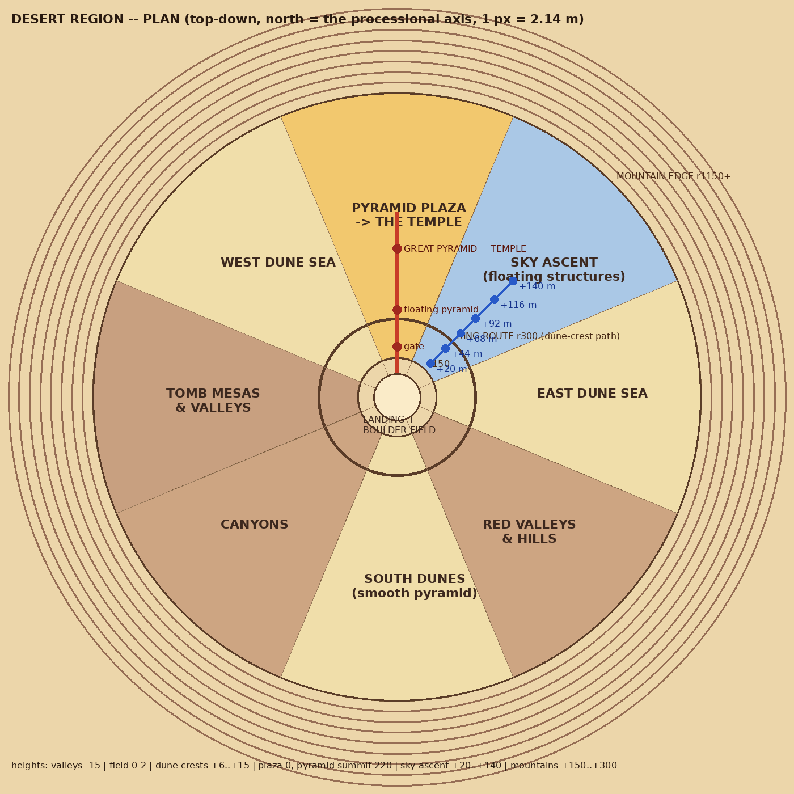
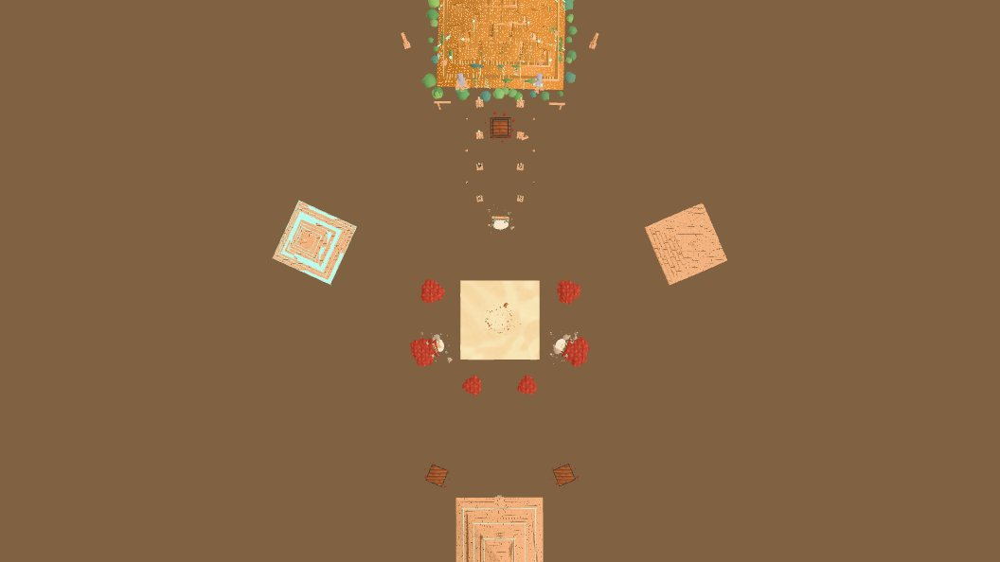

# THE DESERT REGION — the plan (his, Nov 5 2026)

*"Plan the whole area, then build and refine one piece at a time"* — he knows he tends to go too big. This page is the plan;
ROADMAP points here. Built from the DESERT KIT (`dkMake`, `DESERTKIT`, BOULDERS.md), on the field's sacred-geometry plan
(WORLD_PLAN 11), at God-of-War scale (WORLD_PLAN 10), with VERTICALITY (CLAUDE.md).

What is built today, from above (m2538): 

## The organising plan (sacred geometry)

- The **centre** is the landing and the boulder field (the hidden mandala: rings 6–30 m, eight spokes at ±π/8, ±3π/8 …).
- The **processional axis** runs from the landing through the centre to the north (−z): the gate (190 m), the obelisk avenue,
  the great pyramid (560 m) — **THE TEMPLE**.
- The region is **eight sectors** on the mandala's spokes, from r 150 to r 1150, each sector one ZONE. Mirrored pairs where it
  can be: the two dune seas (E / W), valleys and canyons (SE / SW).
- A **ring route** at r 300 (a dune-crest path you can run along) joins the sectors; each zone opens off it.
- **Mountains** ring the edge (r 1150–1500), unreachable framing, the haze between.

## The zones

| zone | sector | extent | height decision (verticality) | what is there | budget (worst view) |
|---|---|---|---|---|---|
| Landing + boulder field | centre | r 0–30 | 0–2 m, floaters to +4 | built (BOULDERS.md) | ≤ 65 draws / 250k |
| **Pyramid plaza → THE TEMPLE** | N (axis) | r 150–700 | plaza 0; pyramid tiers +27/+40, plate layers to +117 (×2 in the field: summit ~230 m); floating pieces +80..+230 | built: gate, avenue, colossi, split obelisks, piers, the gold great pyramid. NEXT: it becomes the temple (an entrance, an interior) | ≤ 65 / 250k |
| **Sky ascent** (floating structures) | NE | r 180–650 | rises **+20 → +140 m** in six stages, hop / wall-run / ledge | the first zone to build (step 5): floating rocks, lintels, split mini-pyramids as platforms; the ruined step pyramid (E) is a landmark it climbs past | ≤ 65 / 250k |
| East dune sea | E | r 300–1150 | crests **+6..+15**, troughs 0; crests SNAKE so you can run them | crested wave dunes, sand deformation everywhere, buried kit pieces, floaters | ≤ 55 / 200k |
| Red valleys & hills | SE | r 300–1150 | valleys cut to **−15**, hills to **+25** | red-rock valleys, arches, caverns, big rocks | ≤ 60 / 230k |
| South dunes (smooth pyramid) | S (back axis) | r 300–1150 | crests +6..+12; the smooth pyramid on the axis | dunes, the smooth pyramid's gatehouse, two ruined floaters overhead | ≤ 55 / 200k |
| Canyons | SW | r 300–1150 | canyon floors **−20**, rims 0 | slot canyons, ledges, carved panels in the walls | ≤ 60 / 230k |
| Tomb mesas & valleys | W | r 150–900 | mesa tops **+25..+30**, the tombs at their feet | the two tomb mesas (built), climbable mesa paths | ≤ 60 / 230k |
| West dune sea | NW | r 300–1150 | crests +6..+15 | mirrored E dune sea; the stepped pyramid (W) on its edge | ≤ 55 / 200k |
| Mountains | edge | r 1150–1500 | **+150..+300**, unreachable | painted + low-poly ranges in haze | in the above |

## Routes

- **The causeway** (built): landing → gate → avenue → the temple, along the axis.
- **The ring route** r 300: a dune-crest path that runs the whole circle and joins every zone.
- **The ascent** (NE): starts at the east pier's lintel (+50) and the floaters beside the ring route, climbs in six stages
  (+20, +44, +68, +92, +116, +140) to a sky platform that looks down on the temple.
- Zone-internal routes climb or descend (valley floors, mesa tops, canyon ledges): reaching something goes UP or DOWN.

## The kit — what exists, what each zone still needs (step 2)

- Exists: floaters (3 species × 2 shapes + scree), cacti / succulents / orbs, leaves, the sand (deformation), dust, the sky;
  blocks, steps, columns, ziggurat, obelisk, arch, panel; pond, palm, reeds, lily; urn ×2, brazier, banner, bones, relic;
  mesa, stair; THE GIANTS: pyramid (smooth / stepped), the gold great pyramid, floating inverted pyramid, trilithon gate, tomb,
  colossus slot (his Tripo statues go here), giant obelisk, split obelisk, pier + floating lintel, split mini-pyramid,
  standing stone; dressing (causeway, rubble, plants, tiny figures).
- **The small pyramid on the kit row is the same design as the great one and he likes it small too: keep both.**
- Missing for the zones: crested dune pieces, canyon wall sections, valley rocks / hills, mountain ranges, ascent platforms
  (stable floating slabs with ledges and wall-run faces), and COLLIDERS for every big piece — above all the pyramids
  (he wants to climb and stand on them).

## Order of work (one build per step)

0. **Performance** — m2538: landing 587k / 83 → 251k / 63. Budget held from then on.
1. **This plan** — DESERT_REGION.md + the map.
2. The kit, finalised: inventory, finish, the missing pieces, real colliders (the pyramids first).
3. Sand everywhere + crested snaking dunes, rocks, valleys, hills.
4. Floating rocks everywhere, several heights, instanced, LOD. **Done m2554** (`DPLACE.sky`: ~130 islands on the spokes x rings, 4 tiers +7..+260 m, 2 draws, CPU-culled; the low tier solid).
5. Then the zones one at a time, starting with the **sky ascent**; refine each before the next. **Sky Ascent pass 1: m2567** (`DPLACE.ascent`: the helix, 64 stones, 6 stages, +140; TOOLS > SKY ASCENT (go)).

## Performance budget (held from m2538)

- Any play view: **≤ 65 draws, ≤ 250k triangles**; aerial / wide: ≤ 80 / 280k. Per-zone numbers above.
- Rules: merge static geometry per material; detail meshes in 200 m cells that hide beyond `DPLACE.far.detail`; instanced
  repeats; nothing complex in building geometry (the detail goes in the maps); ivy and plants cheap.
- Every build reports draws and triangles at the landing and at its busiest view.
