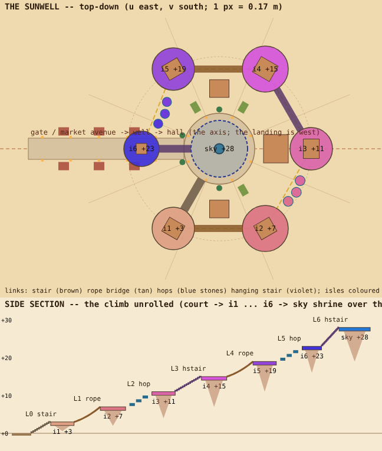

# THE SUNWELL -- the desert village (KORAJIN > desert region, E spoke)

*"We have the kit. Should we build some stuff like a VILLAGE, some FLOATING PLATFORMS with some BUILDINGS on them, some TREASURES, some
VILLAGERS."* (Colin, Nov 5 2026)

A village on the East spoke of the desert region, built from the desert kit (`dkMake` / DKLIB, `DESERTKIT`) plus the village pieces the kit
lacked. Most of it stands on FLOATING ISLES at seven heights (VERTICALITY), climbing round a well. Ancient-alien megalith stone below and
Jinra glyph bands; adobe houses, cloth awnings and lanterns on top. The people are grumpy and funny, in the game's own tone.

## Where (agreed with the desert worker, Nov 5)
- **Sector:** the E axis, theta = +pi/2 from the field's centre `F.c` (between the +3pi/8 and +5pi/8 spokes, framed by mesas m2 / m4), r 240..340,
  so it straddles the ring route r 300 at the inner edge of the East dune sea. The village centre (the well) is at world (290, -6).
- **Mine:** `DVILLAGE` (SC_DVILLAGE), `dvGeo` (DVGEO markers, the layout maths, run by the game AND the checker), the village builder and glue,
  its own isles, its colliders (`col:desert:village*` in `BOULD.colG`), villagers and chests; one field `DPLACE.sky.village` + its skip line in
  `bouldSkyRocks` (the region floaters keep out of theta 1.30..1.84, r 200..380); GODPLACES `dvillage`.
- **The desert worker's:** everything else in DPLACE / BOULD / BOULDLIB, the sand maths (a FLATTEN term over r 55 -> 85 round (290, -6) is
  theirs to add), ENTRY, ZONEWANT. Shared lines diffed after every rebase: SC_DPLACE (my one field), `bouldSkyRocks`.

## The plan (sacred geometry, WORLD_PLAN 11)
- **The axis** runs west to east along the spoke: the GATE (u -46) -> the MARKET AVENUE (three stall pairs, banners, lanterns) -> the
  WELL COURT (r 10, the datum y 0) -> the HALL closing the axis (u 16). The landing is west, so he arrives up the axis.
- **The spiral:** six floating isles every 60 deg round the well (a hexagon on r 26, the last pulled in to r 22), each **+4 m** above the
  last (+3, +7, +11, +15, +19, +23), and the seventh, the **SKY SHRINE (+28)**, hung directly over the well -- the axis mundi: the well looks
  up at it and its Jinra crystal lights the water. From above it reads as a hexagonal spiral round a circle on a line.
- **The court's ring** keeps the octagon and the hexagon: lanterns at 22.5 + k 45 deg, garden beds at +-60 / -120 deg (the L0 stair is the
  fourth), palms at +-90 / +-160 deg.
- **Verticality:** seven planes (0 to +28 m), roots of rock hung under each isle, the route always climbing.

## The route (every link checked by `npm run dvplan` against his body)
| link | from -> to | kind | gap | rise | measure |
|---|---|---|---|---|---|
| L0 | court -> i1 | stone stair | 10.0 | 3 | 10 steps, riser .300, tread 1.00 |
| L1 | i1 -> i2 | rope bridge (sag .45) | 13.5 | 4 | mean 16.5 deg, ends 9 / 23 deg |
| L2 | i2 -> i3 | 3 hop stones (r 1.6) | 13.5 | 4 | worst hop 2.06 m across, 1.00 m up |
| L3 | i3 -> i4 | hanging stair | 13.5 | 4 | 14 steps, riser .286, tread .96 |
| L4 | i4 -> i5 | rope bridge | 13.5 | 4 | as L1 |
| L5 | i5 -> i6 | 3 hop stones (r 1.6) | 13.2 | 4 | worst hop 2.00 m, 1.00 m |
| L6 | i6 -> sky | hanging stair | 9.0 | 5 | 17 steps, riser .294, tread .53 |
`npm run dvwalk` then WALKS it in the shipped page (fake clock, the real pads): every leg arrives. Limits: riser <= .32 (his step is .357), walk slope <= 30 deg, a hop <= 1.6 m up and <= 3 m across (apex 2.8, comfy gap 6.5). A wall-run
face stands on i4 as an optional shortcut, not on the main route.

## What stands where
- **Buildings:** the HALL (ground, closes the axis), two ground houses (N / S of the court), the potter (i1), the weaver (i2, domed), the
  TEAHOUSE (i3, open-sided), the ELDER (i4, two storeys), the MERCHANT (i5, domed), the LANTERN TOWER (i6), the SKY SHRINE (sky).
  Adobe walls (`plain`), fitted stone plinths (`wall` / `pave`), a glyph band (`glyph`), timber beam-ends, flat roofs you can stand on.
- **Village pieces the kit lacked** (new DKLIB pieces): isle, house, hall, teahouse, tower, shrine, market stall + awning, well (rim, frame,
  pulley, rope, bucket, water), lantern post + strung lantern lines, garden bed, windchime, treasure chest, rope bridge, hanging stair, hop stone.
- **Treasure:** chests (the shrine's big one, the lantern tower, the elder's roof, behind the hall, under the L0 stair) open with the
  interact registry (right stick glows; tap) and pop a small reward; clusters of pots (the kit's breakable urns) at stalls and doors.
- **Villagers:** existing NPC rigs and clips -- wanderers on the court and the avenue, a MERCHANT at his stall, kids running the court, a
  grumpy elder on her roof, idle chatter barks when he walks near.

## Budget (DESERT_REGION.md, held from m2538)
Any play view <= 65 draws / 250k tris; aerial <= 80 / 280k. The village merges its static stone, adobe, timber and cloth into one draw per
material (sway in a vertex shader, not per banner), instances the chests, chimes and hop stones, casts shadows only from the big shapes, hides
props / lanterns / villagers past `DVILLAGE.far.detail` (170 m) and the whole village past `far.all` (520 m). Every build reports draws and
tris at the landing, at the court and from the sky shrine -- `npm run dvperf` measures every spot through the real play camera.

## Passes (one build each)
1. **The plan** (this page, the table, `npm run dvplan`, the region floaters kept out of the patch).
2. **Platforms and routes:** the court and its plinth, the avenue, the seven isles, the seven links, all on triangles (`col:desert:village`),
   stairs as `colOnly` ramps, rope bridges as walk strips; GODPLACES `dvillage`.
3. **Buildings.**
4. **Props and treasure:** stalls, well, lanterns, banners, gardens, chimes, pots, chests (interact + reward pop).
5. **Villagers.**

## DONE WHEN
- [x] The plan: sector agreed with the desert worker, layout on the sacred-geometry rule, top-down + section rendered (pass 1).
- [x] The court, avenue and seven isles stand at seven heights, each isle a floating slab with a rock root (pass 2, m2571: close + wide renders).
- [x] Every link of the route is walkable or jumpable -- `npm run dvplan` all ok AND `npm run dvwalk` climbs L0..L6 in the shipped page (pass 2, m2571).
- [ ] Everything collides on its TRIANGLES (`col:desert:village`), stairs on `colOnly` ramps, risers <= .32 (pass 2-4).
- [x] Ten buildings in the house style, flat roofs walkable, CRAFT.md checked close (pass 3, m2578). (His look on the phone still to come.)
- [x] Stalls, well, lanterns, banners, gardens, chimes, pots in place; nothing floats that should touch (pass 4, m2582 close renders).
- [x] Chests open with the interact registry and pop a reward; pots break (pass 4, m2582: open + coins rendered; pots ride the kit's urn path).
- [x] Villagers wander, the merchant minds his stall, a kid runs the court, the elder grumbles on her isle; barks when he is near (pass 5, m2584 -- the bubble is DOM, so his phone is the first to see it).
- [x] Budget held: `npm run dvperf` (the real play camera) at every spot, m2584: worst play view 61 draws (i3) / 244k (i2), aerial 54 / 249k, the landing +0.
- [ ] **His sign-off on his phone.**
