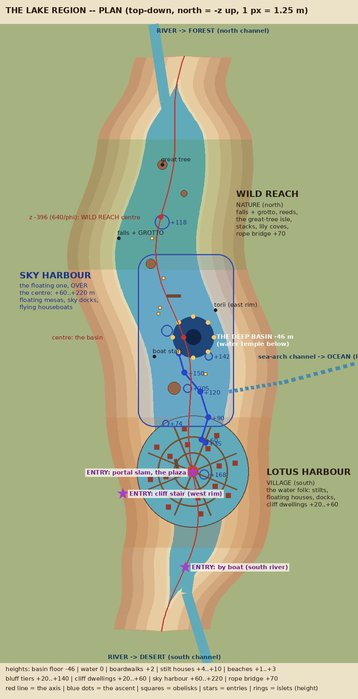
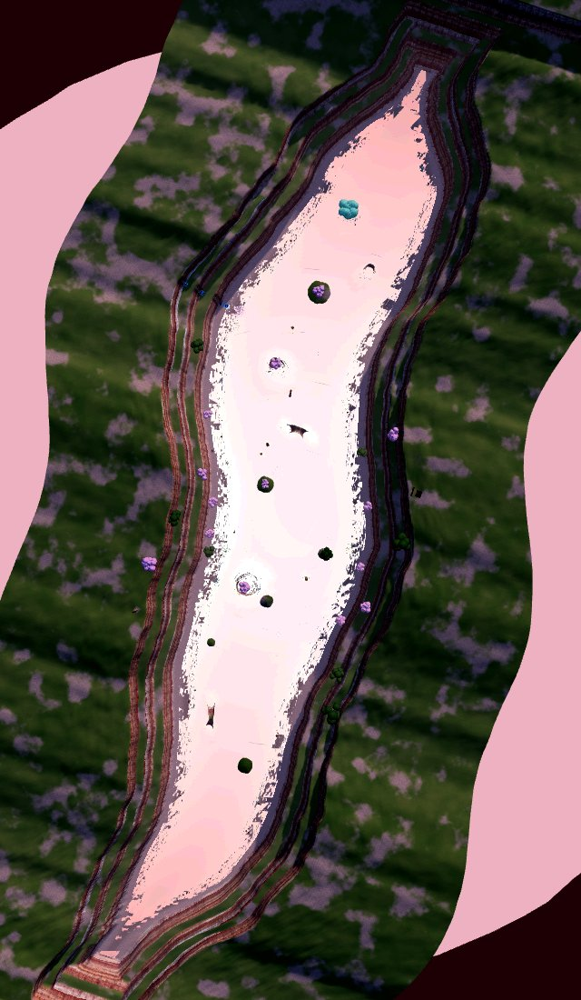

# THE LAKE REGION — the plan (his, Nov 5 2026)

*"There's nowhere really to go in the lake. It needs more entry and more stuff going on, places to go, people to see."*
This page is the plan; ROADMAP points here. Modelled on DESERT_REGION.md: plan the whole area, build a KIT, then build and refine
ONE sub-region at a time. It sits on WATER.md (the look, signed piece by piece), WORLD_PLAN 11 (sacred geometry), 10 (scale), 14
(where the water goes) and 16 (the water folk), with VERTICALITY (CLAUDE.md). The underwater worker owns everything below the
surface (the deep basin, the water temple, diving); this plan is the world ABOVE it.

What stands today, from straight above (m2615, contrast-stretched from the `top_plan` strip shot):

`python3 tools/lakeplan.py` redraws the plan from the SAME canyon formulas the game uses (`cx(z)`, `hw(z)`, `lakeEnd`) and the
SC_LAKE placements, so the map and the place cannot drift apart.

## The organising plan (sacred geometry)

The lake is a long canyon, not a disc, so its geometry is an **axis** rather than a mandala:
- **The processional axis** is the canyon's own centreline, `cx(z)`, running north (−z) to south (+z): river in from the forest →
  Wild Reach → THE BASIN → Lotus Harbour → river out to the desert. The boat sails it, which is how it is felt at water level.
- **The centre** is the deep basin (u 30, z −20, R 64, floor −46 m) with the water temple below. A **ring of eight lantern buoys**
  on r 64 marks it from above, on the eight directions. Over it rises the third sub-region, the Sky Harbour.
- **The two flanking sub-regions** sit at the golden-ratio points of the lake's half-length: **z ±396 = 640/φ**. They mirror each
  other: wild against built, north against south. Their inner edges sit near ±244 = 640/φ².
- **The village is a mandala of its own** inside a round bay: a central round platform, two ring boardwalks at r 60 and r 110, and
  eight radial piers on the spokes at π/8 + kπ/4. Houses sit on the rings, floating houses on the outer water, cliff dwellings in
  the bay wall.
- **Sightlines:** from the harbour plaza north up the axis, the lantern ring, the sky docks overhead and the great tree on its
  isle (z −560) line up. From the Wild Reach looking south, the harbour's lantern tower closes the view.

## The sub-regions

| sub-region | where | extent | height decision (verticality) | what is there | budget (worst view, with shadows) |
|---|---|---|---|---|---|
| **THE BASIN** (centre) | z −20, u 30 | R 64 | the floor −46 (underwater worker); lantern buoys at 0; torii floating at +18 | the ring of eight lantern buoys, a floating torii over the basin, the dark deep pool from the boat | in its neighbours' |
| **LOTUS HARBOUR** (VILLAGE) | south, centre z +396 | the canyon widened into a round **bay R 175**, z +230..+640 | water 0; boardwalks +2; stilt houses +4..+10; the lantern tower +35; cliff dwellings +20..+60 up the bay wall, stairs between | the water folk (WORLD_PLAN 16: stilt and houseboat people): the round market-shrine platform, ring boardwalks, 8 piers with moored houseboats, floating houses, cliff houses, lanterns everywhere, people walking and fishing, herons | ≤ 70 draws / 280k |
| **SKY HARBOUR** (the floating one) | OVER the centre, z −280..+260 | ~300 x 540 m | **+60 → +220 m**: the six existing islets (+74..+205) become its moorings; floating mesas and bases, sky docks, flying houseboats | reached by the **ascent** from the harbour's lantern tower (six stages +35, +60, +90, +120, +150, +185 to the sky docks at +220), and glided down to the basin ring | ≤ 70 / 280k |
| **WILD REACH** (NATURE) | north, centre z −396 | z −230..−640 | water 0; reed shallows 0..+1; the grotto behind the falls at +4..+20; ledges +20..+90; a rope bridge across the canyon at +70 | the falls (built) with a GROTTO behind them, reed beds and lily coves both shores, the great-tree isle (built), the stacks and the broken obelisk (built), wild islets, herons and fish, no people | ≤ 65 / 250k |

## Routes and channels out

- **The axis by boat** (built: the boat sails the whole lake). Lantern buoys mark the basin ring.
- **Channels out** (WORLD_PLAN 14: rivers are the connective tissue): **north** through a gorge to the FOREST region, **south**
  through a cut to the DESERT region, and later **east** through a sea arch toward the OCEAN. Each is a river mouth that opens
  out of the canyon's closed ends (today the canyon closes at |z| 830). Pass 1 builds the mouths and a short reach of river with
  a gate; the regions beyond are other pieces.
- **The ascent** (Sky Harbour): village lantern tower +35 → floating rock steps → the sky docks +220, hop / ledge / wall-run.
- **The cliff stair**: switchbacks from the west rim (+140) down to the village (+2), past the cliff dwellings.
- **The rope bridge** over the Wild Reach at +70, rim to rim, looks down on the falls and the great tree.
- Inside each sub-region, reaching things goes UP or DOWN: the bay wall, the islets, the grotto, the ledges.

## Entries (EVERY ZONE HAS AN ART-DIRECTED ENTRANCE)

Today's ENTRY row lands him on the boat's deck. The plan adds three ways in:
1. **The portal slam on the harbour plaza** (the round platform at the village's centre). This becomes THE `ENTRY` row: purple sky
   portal, flip, superhero landing on the plaza, nothing between the lens and him, the village around.
2. **By boat up the south river**: the boat enters through the river mouth and the harbour opens up ahead.
3. **The cliff stair** down from the west rim, for walking in from the plateau.

## The LAKE KIT (step 2) — reusable, painted (`lkPaint`), colliding, with FLOATING / FLYING versions

One library (`LAKEKIT` markers, `lkKit`), builders as pure functions of a table, merged per material, instanced repeats, every
piece through `lkPaint`, colliders from the drawn meshes (`COLL`, as every zone) or boxes where a mesh is too heavy.
- **Craft:** a skiff (2–3 m), the longboat (built), a **houseboat** (a cabin on a barge), a **flying boat** (the skiff on Jinra lift
  fins, glowing underside), a **flying houseboat** (the houseboat over a floating rock keel and fins).
- **Floating land:** **floating mesas** (flat-topped, strata sides, 10–60 m), **floating bases** (a mesa with a deck and a mooring
  ring), more **floating rocks** (the desert's floaters re-dressed: wet, mossy, dripping), **floating plant islands** (reed / mangrove
  mats with roots hanging into or above the water).
- **Built:** **docks** and **piers** (planked, on posts, posts IN the water), **bridges** (a taiko arch, a plank causeway, a rope
  bridge), **stilt houses** (one-room, two-storey, with a balcony), **floating houses** (on pontoons), **lanterns** (stone tōrō,
  hanging paper, floating, lantern buoys, the lantern tower), mooring posts, reeds, nets, drying racks.
- **CRAFT.md throughout:** posts stand IN the water or on the ground, ropes hang, roofs curve, nothing floats unless it is meant to.
- A **kit row** in the lake (TOOLS > LAKE KIT) shows every piece, so each one can be judged on its own before it is placed.

## Order of work (one build per step, gated: check, bump, check, push; a NOTES entry each)

0. **Performance to budget.** The lake today is **39 draws / 343k tris in the strip, WITHOUT shadows**, which is already over
   280k. So: count with the shadow pass (as the desert's `gshad`), cut the terrain grid and tree tris, cull far trees and rocks
   in cells. Target ≤ 55 / 220k at the boat before anything is added.
1. **This plan:** LAKE_REGION.md and the map. **Done m2615.**
2. **The lake kit** and the kit row: every piece above, painted, colliding, floating / flying versions.
3. **LOTUS HARBOUR** (the village) first, because "people to see": widen the bay, the mandala village, the portal ENTRY moves to
   the plaza, the water folk (placeholders until his Tripo models), lanterns. Refine before moving on.
4. **SKY HARBOUR**: floating mesas and bases on the islets, sky docks, flying houseboats, the ascent from the lantern tower.
5. **WILD REACH**: the grotto behind the falls, reed beds, the rope bridge, wild islets, herons.
6. **The channels out** (river mouths, gates) and the basin ring (lantern buoys, the floating torii).

## Performance budget

- **Counted WITH the shadow pass:** any play view **≤ 70 draws, ≤ 280k triangles**; aerial / wide ≤ 85 / 310k. The same rule as
  the desert (DESERT_REGION.md).
- Rules: merge static geometry per material; the village in a few cells that hide when far; instanced repeats (houses, posts,
  lanterns, reeds, rocks); detail in the paint, not the geometry; one mirror pass (the reflection layer gets only the big shapes).
- Every build reports draws and triangles at the boat, the harbour plaza and its busiest view.
